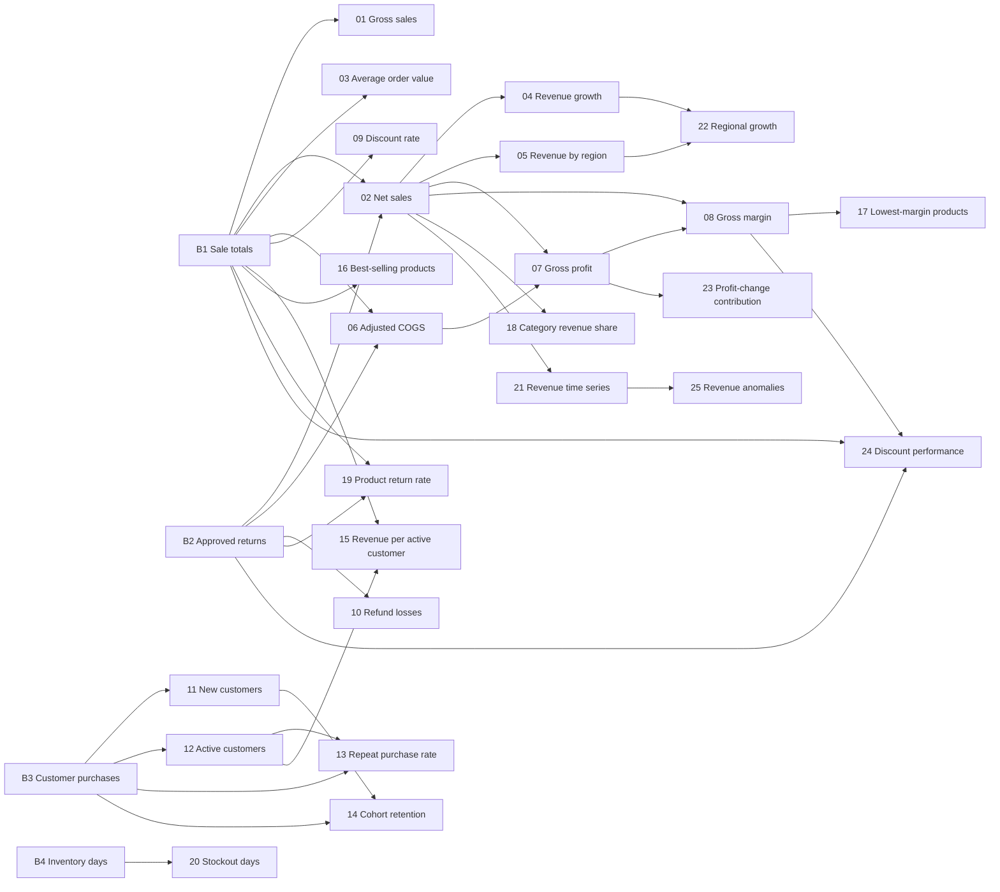

# Analytics metric specification

This document defines the 25 V1 analytics capabilities, the shared calculations behind them, and the hand-calculated fixture that tests them. Metrics 01 to 10 are fully specified for Phases 4.2 to 4.4. Metrics 11 to 25 have planned definitions and dependencies; Phase 9.1 completes their fixture cases before implementation. The accounting rules come from the [schema document](schema.md#accounting-and-reporting-dates).

V1 has exactly these 25 capabilities. Helpers such as `discounted_sales` are internal values, not new capabilities. A change to a formula, filter rule, or rounding rule increments that metric's version. The version appears in every evidence record and in the per-investigation memo key.

## Shared rules

### Terms

- **Revenue** means net sales unless a metric says gross sales.
- **Qualifying order** means an order with status `completed` or `fulfilled`. `pending` and `canceled` orders contribute nothing.
- **Sale line** means an `order_items` row on a qualifying order. Gross sales, discounts, and original cost of goods sold (COGS) are recognized on `orders.ordered_at`.
- **Approved return event** means a `returns` row with status `approved` on a sale line. Refunds and cost reversals are recognized on `returns.returned_at`. Pending and rejected returns contribute nothing.
- **Attribution**: A return event keeps the region of its original order and the category of its original product.

### Periods

A request gives `start_date` and `end_date` as UTC calendar dates. The period is `[start_date 00:00 UTC, end_date 00:00 UTC)`, so January 2025 is `start_date=2025-01-01` and `end_date=2025-02-01`. `end_date` must be after `start_date`. Comparisons use UTC instants, so an order at `2025-02-01T00:30:00+01:00` belongs to January.

### Dataset coverage

Coverage starts on the earliest UTC date among order timestamps, return timestamps, and inventory days. It ends, exclusively, on the day after the latest such date. The seed `42` snapshot covers `[2024-01-01, 2026-01-01)`.

- A requested or comparison period must lie fully inside coverage. Otherwise the metric returns `INSUFFICIENT_DATA` with the coverage in its evidence. The engine never clips a period.
- Inside coverage, a period, region, or category with no events is a true zero. SQL returns no row for an empty group, so the engine fills zero totals for every expected group.

### Filters

Omit a filter to include everything. Unknown values, duplicates, empty lists, and lists longer than ten values are validation errors that stop the request before any SQL runs.

| Filter | Allowed values | Applies to |
| --- | --- | --- |
| `regions` | 1 to 10 distinct values present in `orders.region` | Original order region of sale lines and return events |
| `categories` | 1 to 10 distinct values present in `products.category` | Original product category of sale lines and return events |

### Dimensions

`group_by` is `none`, `month`, `region`, or `category`, as each metric allows.

- `month` lists every calendar month that intersects the period, labeled by its first day. Sale values use the order month and return values use the return month. A month cut by the period boundary is marked `partial`.
- `region` and `category` list every known value, including zero groups, sorted by name. A filter limits the listed groups.
- A group's ratio uses that group's numerator and denominator. A total ratio uses the total numerator and denominator. Never average ratios across groups.
- Group order counts can add up to more than the total. An order with lines in two categories counts once in each category and once in the total.

### Values, units, and rounding

- Money is USD from `NUMERIC(14, 2)` columns. Sums are exact and reported with two decimals. Python uses `Decimal`, never `float`. JSON carries decimals as strings.
- Ratios are fractions, so `0.0857` means 8.57%. Compute them with `Decimal` from exact components and round half up to four decimal places.
- Money averages such as average order value round half up to cents.
- Counts are integers.

### Result status

| Status | Meaning |
| --- | --- |
| `OK` | The value is defined. |
| `NOT_APPLICABLE` | The formula needs a positive denominator and the denominator is zero or negative. The components are still reported. |
| `INSUFFICIENT_DATA` | The period or comparison period is not fully inside coverage. No value is reported. |

Each grouped row carries its own status. Invalid requests are rejected before execution and produce no evidence. Examples are an unknown metric, invalid dates, an unknown filter value, or an unsupported `group_by`.

### Evidence record

Every metric execution produces one evidence record. Every number in a narrative must cite its `evidence_id`.

| Field | Content |
| --- | --- |
| `evidence_id` | Unique within the investigation, such as `ev-003` |
| `metric_key`, `metric_version` | For example `gross_margin` and `1` |
| `status` | Overall status |
| `period`, `comparison_period` | Start and exclusive end dates; the comparison appears only where used |
| `filters`, `group_by` | Normalized filters, sorted and deduplicated, with `null` for an omitted filter |
| `unit` | `USD`, `ratio`, or `count` |
| `value` or `rows` | The total value, or one row per group with its own status |
| `components` | The base values the formula used, including numerator and denominator |
| `sample` | `qualifying_orders`, `sale_lines`, and `approved_return_events` |
| `coverage` | Dataset coverage start and exclusive end |
| `dataset_version` | Snapshot fingerprint, defined in Phase 4.5 |

January 2025 gross margin on the [fixture](#fixture-metrics-v1) produces this record.

```json
{
  "evidence_id": "ev-001",
  "metric_key": "gross_margin",
  "metric_version": 1,
  "status": "OK",
  "period": {"start_date": "2025-01-01", "end_date": "2025-02-01"},
  "filters": {"regions": null, "categories": null},
  "group_by": "none",
  "unit": "ratio",
  "value": "0.5217",
  "components": {"gross_profit": "120.00", "net_sales": "230.00"},
  "sample": {"qualifying_orders": 2, "sale_lines": 3, "approved_return_events": 1},
  "coverage": {"start_date": "2025-01-01", "end_date": "2025-03-01"},
  "dataset_version": "defined-in-phase-4.5"
}
```

### Execution boundary

Analytics run only the registered, parameterized SQL in this document. They use read-only credentials inside one read-only `REPEATABLE READ` transaction per investigation. Dates and filter values are bound parameters. Group keys come from a fixed allowlist in code. The language model never supplies SQL, column names, or expressions.

## Base calculations

### B1 — Sale totals

Sale-line grain, recognized on the order date.

```sql
SELECT {group_key} AS group_key,
       COALESCE(sum(i.quantity * i.unit_list_price), 0) AS gross_sales,
       COALESCE(sum(i.discount_amount), 0)              AS discounts,
       COALESCE(sum(i.quantity * i.unit_cost), 0)       AS sale_cogs,
       COALESCE(sum(i.quantity), 0)                     AS units_sold,
       count(DISTINCT o.id)                             AS qualifying_orders,
       count(i.id)                                      AS sale_lines
FROM order_items AS i
JOIN orders   AS o ON o.id = i.order_id
JOIN products AS p ON p.id = i.product_id
WHERE o.status IN ('completed', 'fulfilled')
  AND o.ordered_at >= :period_start
  AND o.ordered_at <  :period_end
  AND (CAST(:regions AS text[]) IS NULL OR o.region = ANY(:regions))
  AND (CAST(:categories AS text[]) IS NULL OR p.category = ANY(:categories))
GROUP BY 1
```

### B2 — Approved return totals

Return-event grain, recognized on the return date and attributed to the original line.

```sql
SELECT {group_key} AS group_key,
       COALESCE(sum(r.refund_amount), 0)          AS approved_refunds,
       COALESCE(sum(r.quantity * i.unit_cost), 0) AS returned_cogs,
       COALESCE(sum(r.quantity), 0)               AS returned_units,
       count(r.id)                                AS approved_return_events
FROM returns AS r
JOIN order_items AS i ON i.id = r.order_item_id
JOIN orders      AS o ON o.id = i.order_id
JOIN products    AS p ON p.id = i.product_id
WHERE r.status = 'approved'
  AND o.status IN ('completed', 'fulfilled')
  AND r.returned_at >= :period_start
  AND r.returned_at <  :period_end
  AND (CAST(:regions AS text[]) IS NULL OR o.region = ANY(:regions))
  AND (CAST(:categories AS text[]) IS NULL OR p.category = ANY(:categories))
GROUP BY 1
```

`{group_key}` comes from this allowlist only.

| `group_by` | B1 key | B2 key |
| --- | --- | --- |
| `none` | `'all'` | `'all'` |
| `month` | `date_trunc('month', o.ordered_at AT TIME ZONE 'UTC')::date` | `date_trunc('month', r.returned_at AT TIME ZONE 'UTC')::date` |
| `region` | `o.region` | `o.region` |
| `category` | `p.category` | `p.category` |

The engine runs B1 and B2 separately and joins their results by group key, filling zeros for missing groups. A single query that joins returns to sale lines would repeat a sale's values once for each of its return events.

### B3 — Customer purchases

Used by metrics 11 to 15. B3 lists qualifying orders per customer with their UTC order dates. A customer's first purchase is their earliest qualifying order in the whole dataset, independent of the requested period.

### B4 — Inventory days

Used by metric 20. B4 gives closing stock per product per UTC day. A missing row is missing data, never a stockout.

### Shared derived values

| Value | Formula |
| --- | --- |
| `net_sales` | `gross_sales − discounts − approved_refunds` |
| `adjusted_cogs` | `sale_cogs − returned_cogs` |
| `gross_profit` | `net_sales − adjusted_cogs` |
| `discounted_sales` | `gross_sales − discounts`, the order-date value before refunds |

## Metrics 01 to 10

All ten are version `1`. Metrics marked "all four" support `group_by` values `none`, `month`, `region`, and `category`.

| # | Key | Formula | Depends on | Unit | `group_by` | `NOT_APPLICABLE` when |
| ---: | --- | --- | --- | --- | --- | --- |
| 01 | `gross_sales` | Sum of `quantity × unit_list_price` | B1 | USD | All four | Never |
| 02 | `net_sales` | `gross_sales − discounts − approved_refunds` | B1, B2 | USD | All four | Never; can be negative |
| 03 | `average_order_value` | `discounted_sales ÷ qualifying_orders` | B1 | USD | All four | `qualifying_orders = 0` |
| 04 | `revenue_growth` | `(net_sales_P − net_sales_Q) ÷ net_sales_Q` | 02 | Ratio and USD change | `none` | `net_sales_Q ≤ 0` |
| 05 | `revenue_by_region` | `net_sales` per region; share is `net_sales_region ÷ total net_sales` | 02 | USD and ratio | `region` only | Shares only: total ≤ 0 or any region below 0 |
| 06 | `adjusted_cogs` | `sale_cogs − returned_cogs` | B1, B2 | USD | All four | Never; can be negative |
| 07 | `gross_profit` | `net_sales − adjusted_cogs` | 02, 06 | USD | All four | Never; can be negative |
| 08 | `gross_margin` | `gross_profit ÷ net_sales` | 02, 07 | Ratio | All four | `net_sales ≤ 0` |
| 09 | `discount_rate` | `discounts ÷ gross_sales` | B1 | Ratio | All four | `gross_sales = 0` |
| 10 | `refund_losses` | Sum of approved `refund_amount` | B2 | USD | All four | Never |

### Metric notes

- **01 Gross sales** is merchandise value at list price before discounts and refunds, on the order date. The data holds no shipping or tax.
- **02 Net sales** subtracts refunds on their return date. A period with heavy refunds of earlier sales can have negative net sales.
- **03 Average order value** uses discounted sales on the order date, not net sales. Refunds in a period can belong to orders from earlier periods, so subtracting them would mix two order populations. With a category filter, the numerator counts only matching lines and the denominator counts orders with at least one matching line.
- **04 Revenue growth** compares the current period P with a comparison period Q. When P spans whole calendar months, the default Q is the same number of immediately preceding calendar months. Otherwise the default Q is the immediately preceding period with the same number of days. A request can instead set `comparison_start_date` and `comparison_end_date`, which must not overlap P. The record reports both net sales values, `absolute_change`, and `growth`. `absolute_change` is reported whenever both periods are inside coverage. Region and category filters are allowed. The per-region breakdown is metric 22.
- **05 Revenue by region** allows a category filter but not a region filter. Shares are `NOT_APPLICABLE` when the total is not positive or any region is negative, because the shares would not describe parts of a whole. Regional net sales are still reported.
- **06 Adjusted COGS** reverses cost at the original line's `unit_cost`, not the product's later cost. A period with only refunds has negative adjusted COGS.
- **08 Gross margin** for several groups or months comes from summed gross profit and summed net sales.
- **09 Discount rate** uses order-date values only. Refunds do not change it.
- **10 Refund losses** is the amount refunded on approved returns in the period. Its components include `returned_units`, `approved_return_events`, and `returned_cogs`. It is not netted against the cost reversal; that profit effect appears in metrics 02, 06, and 07.

## Metrics 11 to 25

These definitions guide the registry design. Phase 9.1 settles the listed questions, adds fixture cases, and assigns version `1`.

| # | Key | Planned definition | Depends on | To settle in Phase 9.1 |
| ---: | --- | --- | --- | --- |
| 11 | `new_customers` | Customers whose first qualifying order falls in the period | B3 | Whether a region filter applies to the first order's region |
| 12 | `active_customers` | Distinct customers with at least one qualifying order in the period | B3 | — |
| 13 | `repeat_purchase_rate` | Active customers with two or more qualifying orders in the period ÷ active customers | B3, 12 | Within-period repeats or any earlier purchase |
| 14 | `cohort_retention` | Share of each first-purchase-month cohort with a qualifying order in each later month | B3, 11 | Maximum cohort window; cells past coverage are `INSUFFICIENT_DATA` |
| 15 | `revenue_per_active_customer` | `discounted_sales ÷ active_customers` | B1, 12 | — |
| 16 | `best_selling_products` | Top N products, N at most 20, by units sold; ties by discounted sales, then product ID | B1 | Default N |
| 17 | `lowest_margin_products` | Bottom N products by gross margin among products with positive net sales and a minimum number of units sold | 08 | Minimum units |
| 18 | `category_revenue_share` | Net sales by category with the share rule from metric 05 | 02 | — |
| 19 | `product_return_rate` | Approved returned units on lines sold in the period ÷ units sold in the period, per product, counting returns through coverage end | B1, B2 | How to label recent periods whose returns are still arriving |
| 20 | `stockout_days` | Days with closing stock of zero per product in the period, with missing days reported separately | B4 | Reporting consecutive runs |
| 21 | `revenue_time_series` | Net sales by day, week, or month, with zeros filled inside coverage | 02 | Week definition |
| 22 | `regional_growth` | Metric 04 for each region | 04, 05 | — |
| 23 | `profit_change_contribution` | Change in gross profit per region, category, or product between P and Q; share is group change ÷ total change when the total change is not zero | 07 | — |
| 24 | `discount_performance_comparison` | Sale lines grouped into line discount-rate bands, with gross sales, discount rate, net sales, and gross margin per band | B1, B2, 08 | Band boundaries |
| 25 | `revenue_anomaly_detection` | Flags days whose net sales have a robust z-score of at least 3.5 in magnitude against the trailing 28 days' median and median absolute deviation (MAD); needs 28 earlier days; `NOT_APPLICABLE` when MAD is zero | 21 | Window and threshold, checked against the September 16, 2025 spike |

## Dependency graph

Each metric depends only on base calculations or lower-numbered metrics, so the graph has no cycles. The registry will reject a cycle or an unknown dependency at startup.



## Fixture `metrics-v1`

[`tests/fixtures/metrics-v1/`](../tests/fixtures/metrics-v1/) holds six CSV files that pass the snapshot validator. The expected values below were calculated by hand. They were also reproduced by loading the fixture into disposable PostgreSQL 17 and running the B1 and B2 SQL above. Coverage is `[2025-01-01, 2025-03-01)`, set by the inventory rows.

Products are `1` Fixture Headphones in Audio and `2` Fixture Lamp in Lighting.

| Order | Customer | `ordered_at` in UTC | Region | Status | Lines: product, quantity × unit price, line discount, unit cost |
| ---: | ---: | --- | --- | --- | --- |
| 1 | 1 | 2025-01-05 10:00 | East | completed | Line 1: Headphones 2 × 100.00, 20.00, 40.00. Line 2: Lamp 1 × 50.00, 0.00, 30.00 |
| 2 | 2 | 2025-01-31 23:30, stored as `2025-02-01T00:30:00+01:00` | West | fulfilled | Line 3: Headphones 1 × 100.00, 10.00, 40.00 |
| 3 | 1 | 2025-01-20 12:00 | East | canceled | Line 4: Lamp 3 × 50.00, excluded |
| 4 | 3 | 2025-02-01 00:00 | West | completed | Line 5: Lamp 4 × 50.00, 25.00, 30.00 |
| 5 | 2 | 2025-02-14 09:00 | East | pending | Line 6: Headphones 1 × 100.00, excluded |
| 6 | 1 | 2025-02-20 15:00 | East | completed | Line 7: Headphones 1 × 80.00, 0.00, 45.00 |

| Return | Line | Quantity | Refund | `returned_at` in UTC | Status | Effect |
| ---: | ---: | ---: | ---: | --- | --- | --- |
| 1 | 1 | 1 | 90.00 | 2025-01-25 10:00 | approved | January refund 90.00 and cost reversal 40.00, East, Audio |
| 2 | 1 | 1 | 90.00 | 2025-02-03 08:00 | approved | February refund 90.00 and cost reversal 40.00, East, Audio |
| 3 | 3 | 1 | 90.00 | 2025-02-05 12:00 | rejected | None |
| 4 | 5 | 1 | 43.75 | 2025-02-10 12:00 | pending | None |
| 5 | 5 | 2 | 87.50 | 2025-02-25 12:00 | approved | February refund 87.50 and cost reversal 60.00, West, Lighting |

### Expected base totals

| Period | Gross sales | Discounts | Sale COGS | Units | Orders | Lines | Refunds | Returned COGS | Returned units | Return events |
| --- | ---: | ---: | ---: | ---: | ---: | ---: | ---: | ---: | ---: | ---: |
| January | 350.00 | 30.00 | 150.00 | 4 | 2 | 3 | 90.00 | 40.00 | 1 | 1 |
| February | 280.00 | 25.00 | 165.00 | 5 | 2 | 2 | 177.50 | 100.00 | 3 | 2 |
| January and February | 630.00 | 55.00 | 315.00 | 9 | 4 | 5 | 267.50 | 140.00 | 4 | 3 |

### Expected totals for metrics 01 to 10

`group_by=month` over January and February returns the January and February columns as two rows.

| Metric | January | February | January and February |
| --- | ---: | ---: | ---: |
| 01 Gross sales | 350.00 | 280.00 | 630.00 |
| 02 Net sales | 230.00 | 77.50 | 307.50 |
| 03 Average order value | 160.00 | 127.50 | 143.75 |
| 06 Adjusted COGS | 110.00 | 65.00 | 175.00 |
| 07 Gross profit | 120.00 | 12.50 | 132.50 |
| 08 Gross margin | 0.5217 | 0.1613 | 0.4309 |
| 09 Discount rate | 0.0857 | 0.0893 | 0.0873 |
| 10 Refund losses | 90.00 | 177.50 | 267.50 |

The two-month gross margin is 132.50 ÷ 307.50 = 0.4309. Averaging the monthly margins would give 0.3415, which is wrong.

### Expected values by region

| Period | Region | Gross sales | Discounts | Refunds | Net sales | Share (05) | Adjusted COGS | Gross profit | Gross margin |
| --- | --- | ---: | ---: | ---: | ---: | ---: | ---: | ---: | ---: |
| January | East | 250.00 | 20.00 | 90.00 | 140.00 | 0.6087 | 70.00 | 70.00 | 0.5000 |
| January | West | 100.00 | 10.00 | 0.00 | 90.00 | 0.3913 | 40.00 | 50.00 | 0.5556 |
| February | East | 80.00 | 0.00 | 90.00 | −10.00 | `NOT_APPLICABLE` | 5.00 | −15.00 | `NOT_APPLICABLE` |
| February | West | 200.00 | 25.00 | 87.50 | 87.50 | `NOT_APPLICABLE` | 60.00 | 27.50 | 0.3143 |

February East is negative because return 2 refunds a January East sale in February. All February shares are `NOT_APPLICABLE` because East is negative.

### Expected values by category

| Period | Category | Gross sales | Discounts | Refunds | Net sales | Adjusted COGS | Gross profit | Gross margin | Discount rate | Average order value |
| --- | --- | ---: | ---: | ---: | ---: | ---: | ---: | ---: | ---: | ---: |
| January | Audio | 300.00 | 30.00 | 90.00 | 180.00 | 80.00 | 100.00 | 0.5556 | 0.1000 | 135.00 |
| January | Lighting | 50.00 | 0.00 | 0.00 | 50.00 | 30.00 | 20.00 | 0.4000 | 0.0000 | 50.00 |
| February | Audio | 80.00 | 0.00 | 90.00 | −10.00 | 5.00 | −15.00 | `NOT_APPLICABLE` | 0.0000 | 80.00 |
| February | Lighting | 200.00 | 25.00 | 87.50 | 87.50 | 60.00 | 27.50 | 0.3143 | 0.1250 | 175.00 |

February Audio adjusted COGS is 45.00 − 40.00 = 5.00. The sale on order 6 cost 45.00, and return 2 reverses line 1's original 40.00 cost.

### Expected revenue growth, February compared with January

| Filter | January net sales | February net sales | Absolute change | Growth | Status |
| --- | ---: | ---: | ---: | ---: | --- |
| None | 230.00 | 77.50 | −152.50 | −0.6630 | `OK` |
| Region East | 140.00 | −10.00 | −150.00 | −1.0714 | `OK` |
| Region West, category Lighting | 0.00 | 87.50 | 87.50 | — | `NOT_APPLICABLE` because comparison net sales are 0 |

### Expected zero, not-applicable, and insufficient-data cases

| Request | Expected result |
| --- | --- |
| February, region West, category Audio | Metrics 01, 02, 06, 07, and 10 return true zeros with `OK`. Metric 03 is `NOT_APPLICABLE` with 0 orders. Metric 08 is `NOT_APPLICABLE` with 0.00 net sales. Metric 09 is `NOT_APPLICABLE` with 0.00 gross sales. |
| February, category Audio | Metric 08 is `NOT_APPLICABLE` because net sales are −10.00. |
| Metric 04 for January 2025 with the default comparison | `INSUFFICIENT_DATA`, because December 2024 is before coverage |
| Any metric from 2024-12-01 to 2025-01-01 | `INSUFFICIENT_DATA` |
| Any metric from 2025-02-15 to 2025-03-15 | `INSUFFICIENT_DATA`, because the period extends past coverage and is not clipped |
| Filter region `North` | Validation error, because the fixture has no North orders |

### Edge cases the fixture covers

- Canceled order 3 and pending order 5 are excluded.
- Order 2's `+01:00` timestamp falls in the previous UTC month. Order 4, at exactly `2025-02-01T00:00:00Z`, belongs to February.
- Line 1 is returned in two parts across two months, and both returns keep the East region.
- Pending return 4 and rejected return 3 have no effect.
- Order 6 shows historical price and cost snapshots, and return 2 reverses the original cost.
- February East and February Audio have negative net sales and gross profit.
- Zero denominators and true zeros inside coverage.
- Total ratios come from totals, never from averaged group ratios.

## Decisions to confirm

The master plan and schema document did not settle these choices. Phase 4.2 builds on them unless they change.

1. Revenue means net sales.
2. Average order value and revenue per active customer use discounted sales before refunds.
3. A period partly outside coverage returns `INSUFFICIENT_DATA` instead of being clipped.
4. Shares are `NOT_APPLICABLE` when the total is not positive or any group is negative.
5. The default growth comparison is the preceding calendar months for whole-month periods, and otherwise the preceding period of equal length.
6. Ratios round half up to four decimal places.
